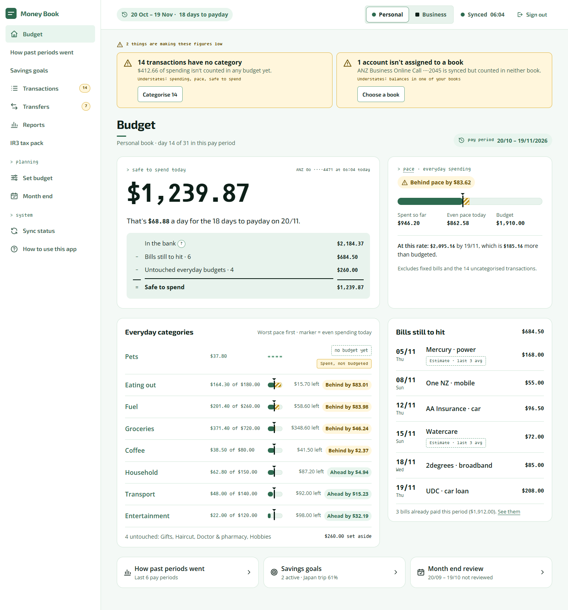

# Tommy's Money Book

A self-hosted personal finance app for New Zealand, built to replace a
long-suffering Excel expense tracker. It pulls bank transactions automatically
through the [Akahu](https://www.akahu.nz) open banking API, keeps personal and
sole-trader business books strictly separate, and produces the figures behind
a real IR3 tax return.

Single user, runs on a homelab, LAN/Tailscale only. Nothing is exposed to the
internet.

<picture>
  <source media="(prefers-color-scheme: dark)" srcset="docs/images/budget-dark.png">
  
</picture>

<sub>The Budget screen, from the design canvas. Every figure is made up.</sub>

**Full documentation is in the [wiki](https://github.com/tonkatommy/tommys-money-book/wiki)**:
the [user guide](https://github.com/tonkatommy/tommys-money-book/wiki/User-Guide),
[setup](https://github.com/tonkatommy/tommys-money-book/wiki/Getting-Started),
[deployment](https://github.com/tonkatommy/tommys-money-book/wiki/Deployment)
and the [design decisions](https://github.com/tonkatommy/tommys-money-book/wiki/Design-Decisions).

## Why

Spreadsheets work until they don't. Manual CSV downloads from two banks,
hand-categorised transactions, formulas that silently break, and a file one
sync conflict away from corruption. This replaces all of that with:

- **Automatic daily bank feeds.** ANZ and BNZ under one Akahu profile, synced
  every morning and reconciled against the bank's own balance. No CSVs, ever.
- **Two sets of books, one database.** Every account and category belongs to
  the personal or the business book, enforced on every write rather than by
  discipline.
- **Transfers that net to zero.** Moves between your own accounts are linked
  pairs, never counted as income or spending.
- **Rules, not hand-sorting.** About 140 rules categorise 82% of transactions
  automatically, and a correction made by hand is never overwritten.
- **Tax-aware reporting.** Categories carry tax tags, so the NZ financial
  year, the GST threshold monitor and the IR3 pack don't depend on what the
  categories are called.
- **A pay-period budget.** Safe to spend today, pace against budget, bills
  still to come, and a month-end close.

The design goal behind all of it: the failure this app guards against isn't
a crash, it's a number that is quietly wrong while every total still
balances.

## Stack

Next.js 16 (App Router, Server Actions, server components throughout),
PostgreSQL with Prisma 7, a node-cron sync worker, Tailwind 4, Vitest.
Deployed with Docker Compose behind nginx, with nightly `pg_dump` backups and
release-driven deploys over Tailscale.

```text
┌─ Homelab (Docker Compose) ─────────────────────────┐
│                                                    │
│  ┌────────────┐   ┌─────────────┐   ┌────────────┐ │
│  │  Next.js   │──▶│ PostgreSQL  │◀──│ Sync worker│─┼──▶ Akahu API
│  │ (UI + API) │   │             │   │  (cron)    │ │
│  └────────────┘   └─────────────┘   └────────────┘ │
│        ▲               │                           │
│      nginx        nightly pg_dump ──▶ backup vol   │
└────────────────────────────────────────────────────┘
        ▲  LAN / Tailscale only, no port forwarding
```

## Quick start

No Akahu tokens needed: the app ships with fixture data (two years of fake
transactions across a fake ANZ and BNZ account) and uses it by default.

```bash
git clone https://github.com/tonkatommy/tommys-money-book.git
cd tommys-money-book
cp .env.example .env    # set POSTGRES_PASSWORD, APP_PASSWORD and SESSION_SECRET
npm install
docker compose up -d db
npm run db:migrate
npm run sync:baseline
npm run accounts:map -- "BNZ Tommy Tinkers" BUSINESS
npm run categories:seed -- --verify
npm run transfers:detect -- --confirm
npm run categories:apply -- --confirm
npm run dev
```

Then open <http://localhost:3000>. The
[Getting Started](https://github.com/tonkatommy/tommys-money-book/wiki/Getting-Started)
page explains each step and how to go live with real Akahu data, and
[Commands](https://github.com/tonkatommy/tommys-money-book/wiki/Commands)
covers every script.

## Status

| Phase | What it delivered | |
| --- | --- | --- |
| 0 | Scaffolding: Next.js, Prisma and Postgres in Docker Compose | ✅ |
| 1 | Bank feeds: Akahu baseline pull, daily sync, balance reconciliation | ✅ |
| 2 | Categories: built from real data, rule-based categorisation, transfer pairing | ✅ |
| 3 | MVP: transactions, pay-period budget, FY reports and GST monitor (go-live) | ✅ |
| 4a | IR3 pack at `/reports/ir3`, with `.xlsx` export | ✅ |
| 4b | Budget history over six complete pay periods | ✅ |
| 4c | Savings goals tracked against real account balances | ✅ |

Running against real bank data from 16/07/2025. What each phase found along
the way is in
[Project History](https://github.com/tonkatommy/tommys-money-book/wiki/Project-History).

## Documentation

| Where | What |
| --- | --- |
| [Wiki](https://github.com/tonkatommy/tommys-money-book/wiki) | User guide, setup, deployment, backups, design decisions |
| [docs/implementation-plan.md](docs/implementation-plan.md) | Architecture, data model and phase plan |
| [docs/superpowers/specs/](docs/superpowers/specs/) | The design spec for each phase |
| [AGENTS.md](AGENTS.md) | Working agreement, stack, invariants and house style for contributors |
| [.github/skills/code-review/SKILL.md](.github/skills/code-review/SKILL.md) | The domain invariants, and which odd-looking decisions are deliberate |

Built in the open as a learning and portfolio project.
